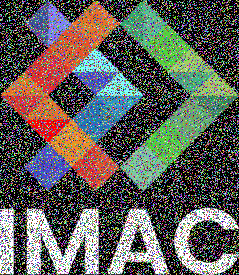
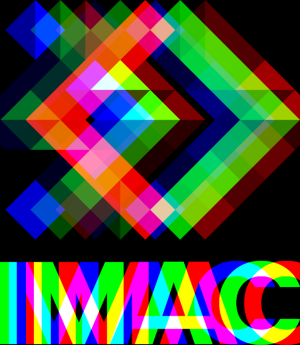
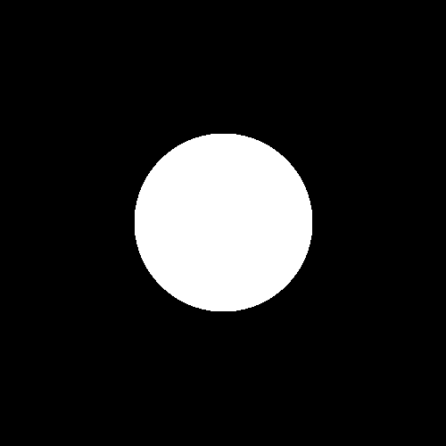
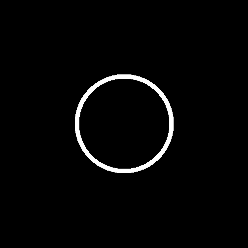
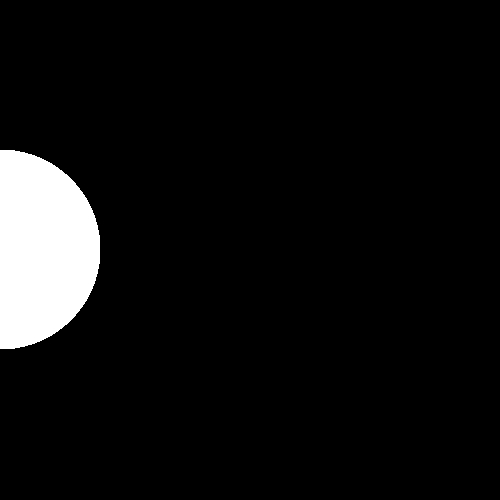
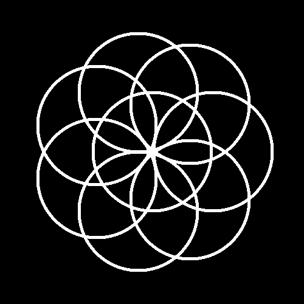
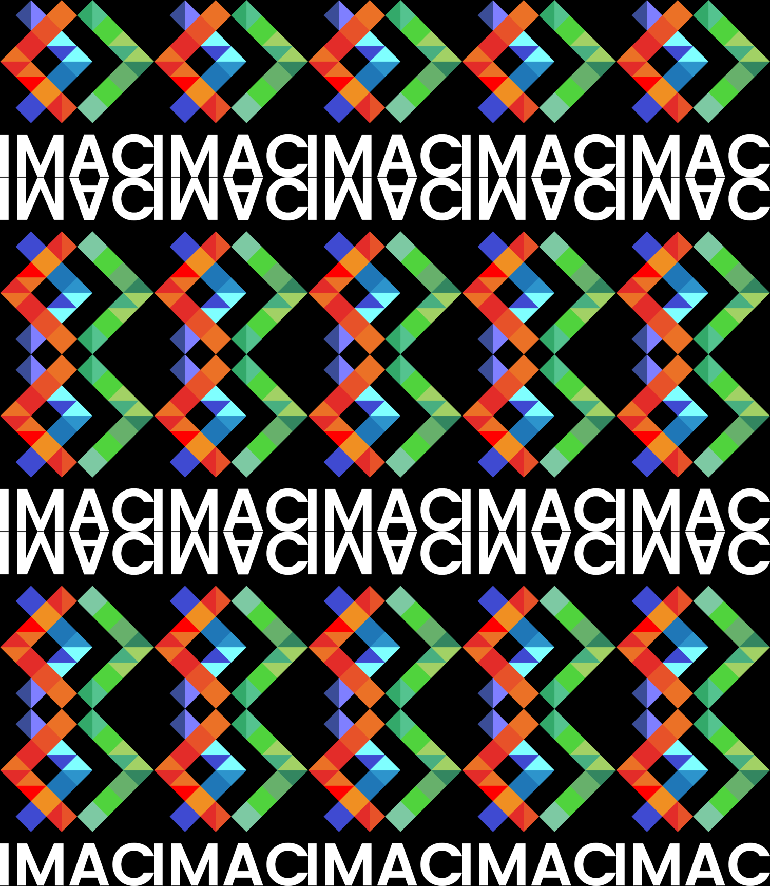
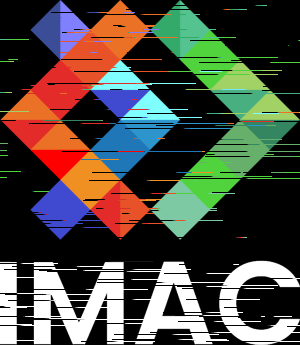
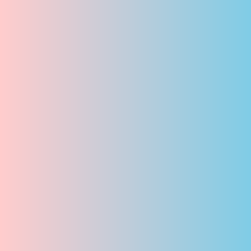
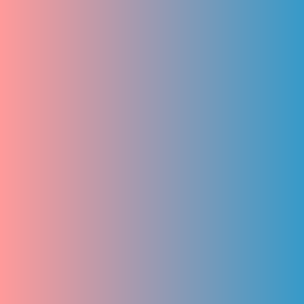

# 🐣 S1 | Prog: Workshop

Template de projet pour le workshop de prog des Imac1. Vous trouverez le sujet ici: https://dsmte.github.io/Learn--cpp_programming/Workshop

## Exo 1 : Ne garder que le vert

## Exo 2 : Échanger les canaux

## Exo 3 : Noir & Blanc

Utiliser la formule pour obtenir la luminosité des couleurs et mettre tous les canaux à cette valeur.

## Exo 4 : Négatif

## Exo 5 : Dégradé

## Exo 6 : Miroir

## Exo 7 : Image bruitée

## Exo 8 : Rotation de 90°

## Exo 9 : RGB split

## Exo 10 : Luminosité

|  |  |  |
| ----------------------------------- | ----------------------------------------- | -------------------------------------- |

## Exo 11 : Disque

## Exo 12 : Cercle

## Exo 13 : Animation

## Exo 14 : Rosace

## Exo 15 : Mosaïque

## Exo 16 : Mosaïque miroir

## Exo 17 : Glitch

## Exo 18 : Tri de pixels

|  |  |  |
| -------------------------------------------- | ------------------------------------------------- | ----------------------------------------------------- |

## Exo 19 : Fractale de Mandelbrot

## Exo 20 : Dégradés dans l'espace de couleur Lab

| sRGB                                                                          | Linear RGB                                                                                      |
| ----------------------------------------------------------------------------- | ----------------------------------------------------------------------------------------------- |
|  |  |

## Exo 21 : Tramage

